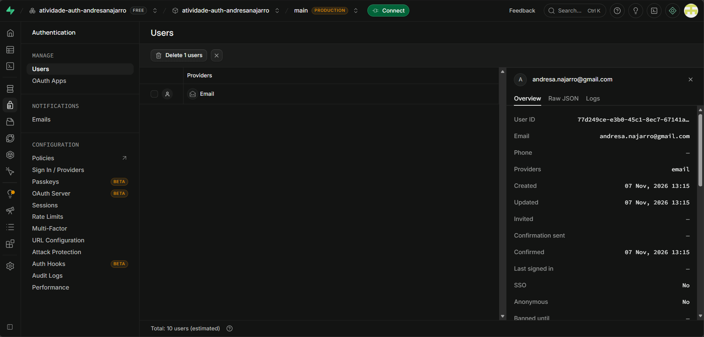
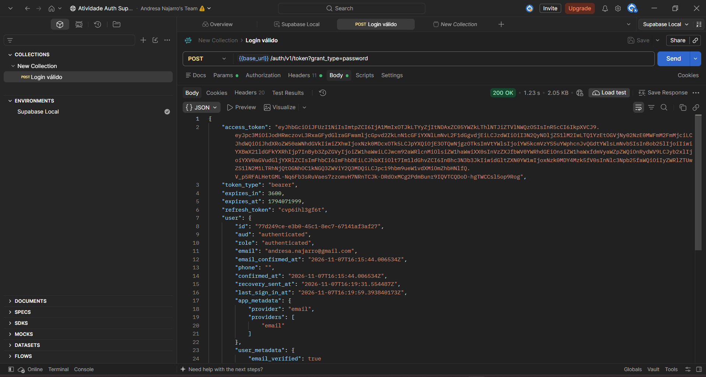
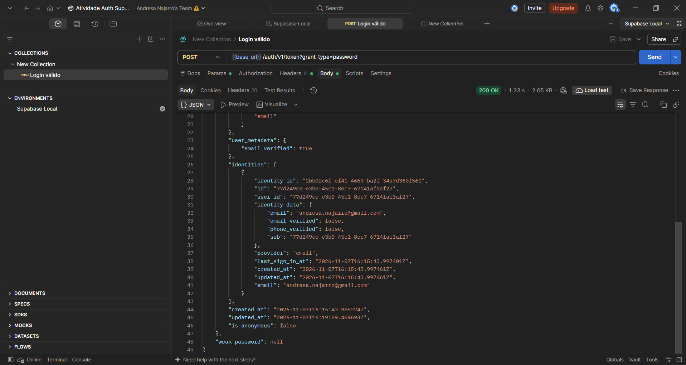
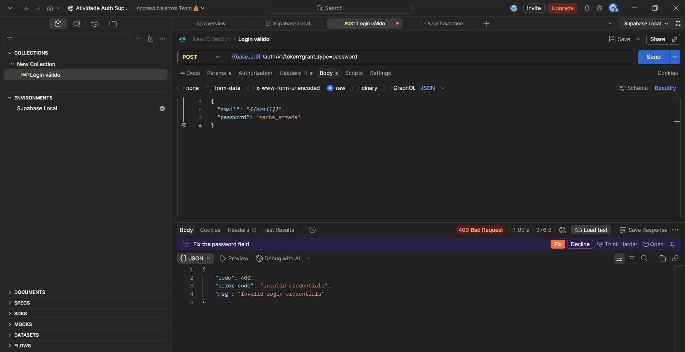
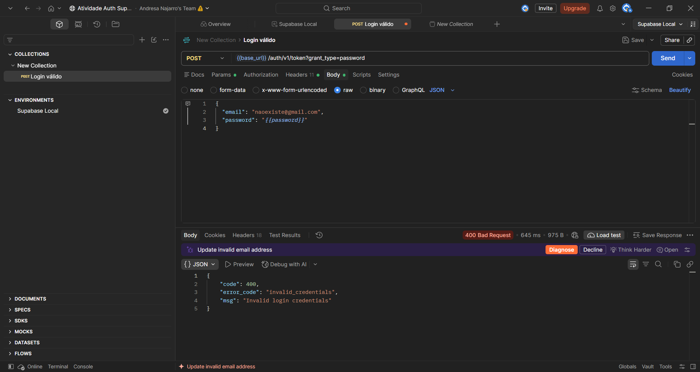
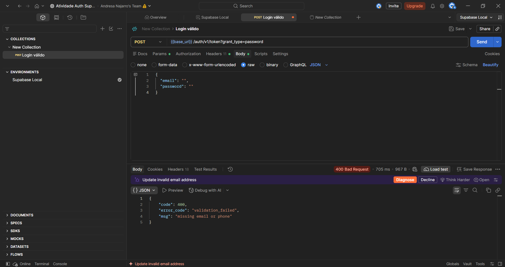
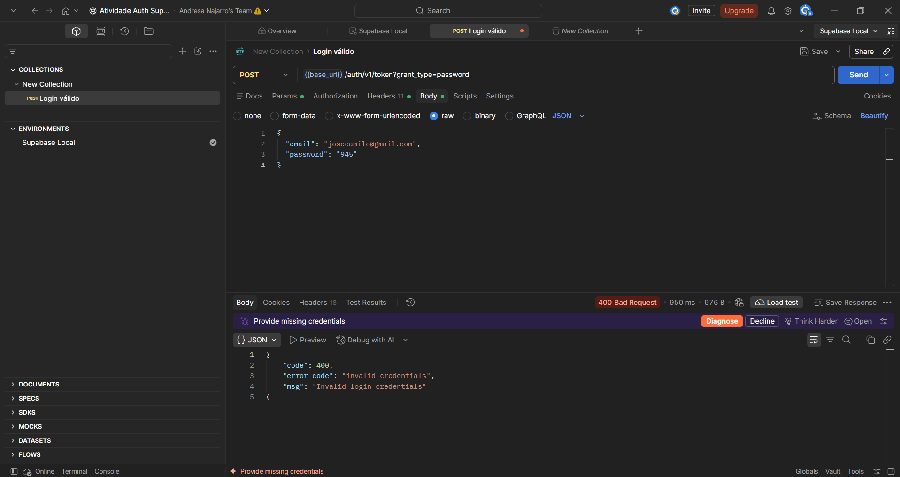

# Introdução

Este repositório contém a documentação e as evidências da atividade prática de Testes de Caixa Cinza em APIs de autenticação, utilizando o Supabase como provedor de identidade e o Postman Desktop para a execução das requisições HTTP.

Nome: Andresa Cristina Najarro de Campos

RA: 251538

# Objetivo da Atividade

O objetivo desta atividade foi compreender e aplicar testes de caixa cinza em APIs de autenticação, configurando um ambiente real no Supabase, criando usuários de teste, estruturando requisições HTTP no Postman e validando os diferentes cenários de resposta (sucesso e erro) da API.

# Configuração do Supabase

- **Criação do Projeto:** Foi criado um projeto no Supabase chamado `atividade-auth-andresanajarro`.
- **Autenticação:** Foi habilitada a autenticação por e-mail e senha. A opção de "Confirm email" foi desativada para permitir testes imediatos.
- **Usuário de Teste:** Foi criado um usuário válido (com domínio de e-mail real) para a realização dos testes de login.
- **Credenciais:** A URL do projeto e a chave pública (Publishable/anon key) foram obtidas no painel do Supabase para configurar o Postman.

*Evidências:*

# Configuração do Postman

- **Workspace:** Foi criado o Workspace "Atividade Auth Supabase".
- **Environment:** Foi criado o ambiente "Supabase Local" contendo as variáveis: `base_url`, `api_key`, `email` e `password`. Isso permite que os testes sejam executados de forma dinâmica e segura, sem expor os dados diretamente na URL ou no corpo fixo da requisição.
- Os arquivos exportados da Collection e do Environment estão disponíveis na pasta `/postman`.

# Configuração das Requisições

- **Endpoint:** `/auth/v1/token?grant_type=password`
- **Método HTTP:** `POST`
- **Headers:** `apikey` (para autorizar a requisição na API do Supabase) e `Content-Type: application/json`.
- **Body:** Envio de um JSON contendo `email` e `password`.

*Evidências:*

# Execução dos Testes

Foram executados os 5 cenários obrigatórios utilizando o Postman Desktop. As respostas da API foram validadas observando o status HTTP, o corpo JSON retornado e a presença do `access_token` nos casos de sucesso.

*Tabela de Cenários:*

| Cenário | Entrada Utilizada | Resultado Esperado | Resultado Obtido | Status |
| :--- | :--- | :--- | :--- | :--- |
| Login válido | Usuário e senha corretos | Status 200 + access token | 200 OK + token retornado | OK |
| Senha incorreta | Usuário correto, senha errada | Erro de autenticação | 400 Bad Request | OK |
| Usuário inexistente | E-mail não cadastrado | Acesso negado | 400 Bad Request | OK |
| Campos vazios | E-mail e senha vazios | Erro de validação | 400 Bad Request | OK |
| Credenciais inválidas | E-mail malformado, senha curta | Mensagem de erro | 400 Bad Request | OK |

*Evidências:*

**Login Válido (200 OK):**

**Senha Incorreta:**

**Usuário Inexistente:**

**Campos Vazios:**

**Credenciais Inválidas:**

# Registro dos Testes

Os testes foram registrados em uma planilha contendo ID, cenário, entradas, resultados esperados/obtidos, status e observações. A documentação é essencial para garantir a rastreabilidade dos testes e permitir que outros desenvolvedores entendam o comportamento da API.

*Evidências:*

[Planilha de Testes]

# Resultados Obtidos

Todos os cenários planejados foram executados com sucesso. A API respondeu conforme o esperado:
- O login válido retornou o token de acesso (JWT) e os dados do usuário.
- Os erros de autenticação (senha errada e usuário inexistente) retornaram a mesma mensagem genérica (`invalid_credentials`), o que é uma boa prática de segurança para não revelar se um e-mail está cadastrado ou não.
- Campos vazios e formatos inválidos foram barrados pela validação da API com status 400.

# Conclusão

A execução desta atividade permitiu compreender na prática como funciona o fluxo de autenticação de uma API moderna (Supabase) e como validá-la utilizando o Postman. 

Os testes foram executados corretamente e a autenticação funcionou perfeitamente. A principal dificuldade encontrada foi a transição para as novas chaves de API do Supabase (Publishable) e a restrição de domínios de e-mail falsos para cadastro, o que exigiu a criação de um usuário com e-mail real.

Não foram identificadas falhas de segurança nos comportamentos observados, visto que a API protegeu as rotas e retornou mensagens de erro genéricas para credenciais inválidas. Como melhoria, poderia ser implementado um limite de tentativas de login (rate limiting) no projeto, embora o próprio Supabase já possua configurações nativas para isso.

A importância dos testes de caixa cinza em APIs reside no fato de que eles permitem validar o comportamento da aplicação conhecendo apenas parte de sua estrutura (endpoints, headers, payloads), garantindo que as regras de negócio e a segurança estejam funcionando antes mesmo de qualquer interface gráfica ser desenvolvida.
